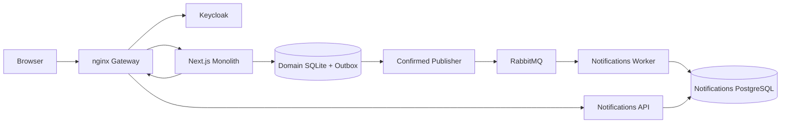

# Notifications: ขอบเขตและคู่มือส่งต่อ

## เปิดใช้งาน

ต้องมี Docker Desktop ที่ใช้ Linux containers ผ่าน WSL 2 และอินเทอร์เน็ตในครั้งแรก
เปิด PowerShell ในโฟลเดอร์โปรเจกต์แล้วรัน:

```powershell
powershell.exe -NoProfile -ExecutionPolicy Bypass -File .\start-notifications.ps1
```

คำสั่งสร้างการตั้งค่าเฉพาะเครื่อง เปิดระบบ เชื่อม Keycloak นำเข้าแจ้งเตือนเก่า
และทดสอบการทำงานจริง ไม่ต้องติดตั้ง Node หรือ Python บนเครื่องเพื่อเปิดระบบ
ไฟล์ `.env.notifications` เป็นความลับเฉพาะเครื่องและไม่ส่งขึ้น Git

| หน้าจอ | URL |
|---|---|
| เว็บไซต์ | http://localhost:8080 |
| กล่องแจ้งเตือน | http://localhost:8080/notifications |
| Dashboard | http://localhost:3000/d/notifications |
| Trace | http://localhost:16686 |
| API docs | http://localhost:8080/notification-docs |

บัญชีเดโม: `nong@example.com` (ลูกค้า), `sparkle@example.com` (ผู้ให้บริการ),
`admin@edemand.test` (ผู้ดูแล) รหัสผ่านร่วม `eDemand-2026!` สำหรับเดโมเท่านั้น
ใช้ชื่อ localhost เพื่อให้ตรงกับการเข้าสู่ระบบ

## สิ่งที่อยู่ในงานนี้



- API แยกและฐานข้อมูลของ Notifications เอง พร้อมตรวจเจ้าของข้อมูล
- เข้าสู่ระบบผ่าน Keycloak และสมัครบัญชีใหม่เชื่อมกับ Keycloak
- เหตุการณ์ธุรกิจผ่าน transactional outbox, RabbitMQ และการป้องกันข้อความซ้ำ
- กดอ่านแล้วด้วย Idempotency-Key และ retry แบบมี timeout/backoff/jitter
- ย้ายแจ้งเตือนเก่า เก็บเจ้าของ เวลา ภาษาไทย และสถานะอ่านไว้ รันซ้ำไม่เพิ่มข้อมูลซ้ำ
- Dashboard, Trace และ logs สำหรับตามหาปัญหา
- Pact HTTP contract 5 กรณี และไฟล์ GitHub Actions สำหรับทดสอบและสร้าง image

## ตรวจรับรอบสุดท้าย

```powershell
powershell.exe -NoProfile -ExecutionPolicy Bypass -File .\check-notifications-final.ps1 -CleanStart
```

คำสั่งนี้เปิดระบบ ตรวจการนำเข้าซ้ำ ตรวจสิทธิ์ จำลองระบบช้า/ล่ม ตรวจการกู้คืน
และตรวจ Dashboard/Trace จากนั้นหยุดเว็บเดิมชั่วคราวเพื่อเปิดจาก source ที่ไม่ติดไฟล์
เฉพาะเครื่องและใช้ volumes ใหม่ เมื่อจบจะคืนระบบเดิม โดยเก็บฐานข้อมูลเดิมไว้
เฉพาะ volumes ของโครงการทดสอบที่สร้างใหม่จะถูกลบ โฟลเดอร์ทดสอบชั่วคราวอาจยังอยู่
จึงควรรันช่วงที่ทีมไม่ได้ใช้งานเว็บ

ผลจะถูกบันทึกเมื่อผ่านจริงเท่านั้นใน `docs/evidence/notifications-final-latest.json`
ถ้าล้มเหลวให้แก้แล้วรันใหม่ อย่าใช้ไฟล์ PASS เก่ามาอ้างว่าเวอร์ชันล่าสุดผ่าน
การตรวจ source ใหม่ไม่ต้องติดตั้ง Git และไม่ได้ส่งโค้ดออกไป
รายการ source มาจาก `.clean-source.json` โดยตัดรหัสผ่าน ฐานข้อมูล และไฟล์ที่สร้างตอนรันออก

## สถานะที่พิสูจน์แล้วก่อนตรวจรับชุดใหม่

- Node unit tests 72 รายการ และ Python tests 31 รายการผ่าน
- Pact ฝั่งเว็บและ FastAPI ผ่าน 5 กรณี และตรวจพบสัญญาตอบกลับที่ผิดโดยตั้งใจ
- บน Docker ผ่านการสมัคร/เข้าสู่ระบบจริง ตรวจ token/สิทธิ์ ระบบช้า/ล่ม
  ข้อความซ้ำ การ restart broker/worker และ Dashboard/Trace
- ชุดนำเข้าข้อมูลเก่าและ root Compose ที่ปรับล่าสุดยังต้องรันตรวจรับบน Docker
- CI เตรียมแล้ว แต่ยังไม่อ้างว่ารันผ่านบน GitHub จนกว่าจะส่งโค้ดและเห็นผลจริง

## แนวเดโม

1. เปิดด้วยคำสั่งเดียวและแสดงผลตรวจรับ
2. เข้าบัญชีลูกค้า สร้างการจอง แล้วเข้าบัญชีผู้ให้บริการดูแจ้งเตือน
3. กดอ่านแล้ว แสดงว่าบัญชีอื่นแก้แจ้งเตือนนี้ไม่ได้
4. แสดงผลทดสอบระบบช้า/ล่มและข้อความซ้ำ พร้อมหลักฐานว่ามีผลครั้งเดียว
5. เปิด Dashboard แล้วใช้ trace ID ตามคำขอจากเว็บไปยังบริการ
6. แสดง Contract Test และผล CI ของ commit ที่ส่งงานจริง

## ข้อจำกัดและงานของทีม

Notifications เป็น service ที่แยกแล้วหนึ่งตัว ส่วน Booking, Provider และ Payments
ยังอยู่ใน monolith การทำ Service ที่ 2 และ Saga ไม่รวมอยู่ในชุดนี้
Keycloak ใช้โหมดพัฒนาและ H2 ส่วน Jaeger เก็บ trace ในหน่วยความจำและหายเมื่อ restart
Logs อยู่ใน Docker stdout ยังไม่มีระบบรวม logs แยกต่างหาก
Access token มีอายุ 5 นาทีแล้วต้องเข้าสู่ระบบใหม่
ยังต้องวัดหน่วยความจำสูงสุดกับข้อกำหนด 8 GB และเตรียมคลิป/รายงานรวมของทีม
การทดสอบข้อความซ้ำไม่ใช่หลักฐานว่าแก้ race condition เดิมของโจทย์แล้ว

เอกสารแยก: [migration](notifications-migration.md), [contracts/CI](contracts-and-ci.md),
[resilience](notifications-resilience.md), [recovery](broker-worker-recovery.md),
[observability](observability.md), [registration](registration-keycloak.md)
